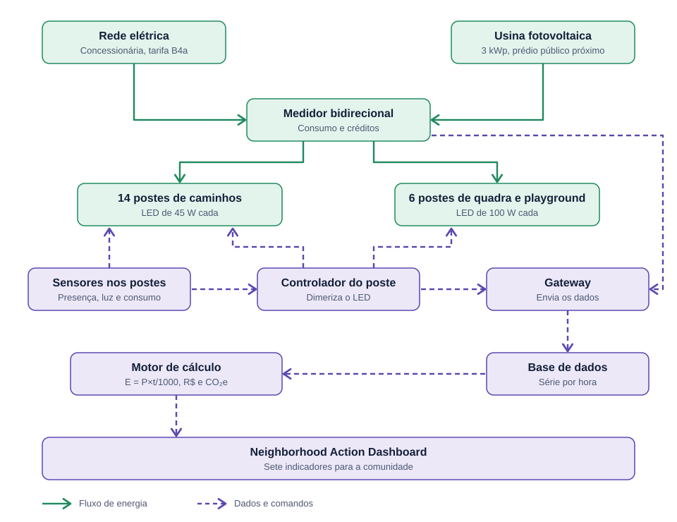

# Praça Solar

**Contribuição de SERS (Soluções em Energias Renováveis e Sustentáveis) ao Neighborhood Action Dashboard, CitizenTech.**
Global Solution 2026.2, Ciência da Computação.

> Todas as estimativas de economia, geração renovável e redução de impacto deste projeto são **projeções condicionadas às premissas adotadas**, e não resultados garantidos.

| | |
|---|---|
| Site (dashboard) | `https://raw-exe.github.io/site-citzentech-sustentave/` |
| Vídeo técnico | `PREENCHER: link do vídeo` |

## Integrantes

| Nome completo | RM |
|---|---|
| `Raul Santos Fernandes` | `576065` |
| `Arthur Monteiro` | `575166` | 

## Resumo

Uma praça comunitária de bairro tem 20 postes com lâmpadas de vapor de sódio acesos em potência total das 18h às 6h. Mesmo de madrugada, quando quase ninguém circula, a praça consome o mesmo que às 19h. Este projeto mede esse desperdício, compara três melhorias para a mesma necessidade de iluminação e apresenta os resultados em um dashboard com sete indicadores.

A solução recomendada combina **LED com dimerização e sensores de presença** e **créditos de energia de um sistema fotovoltaico de 3 kWp** instalado em um prédio público próximo. Na projeção, ela reduz o consumo da rede de 796 para 35 kWh/mês, com retorno do investimento em cerca de 7,2 anos.

## Estrutura do repositório

Este repositório contém **apenas a contribuição de SERS**. Se o grupo usar um repositório compartilhado com outras disciplinas, esta pasta é a parte de SERS.

```
index.html              Site: as 7 seções do dashboard
css/style.css           Visual
js/model.js             Todo o cálculo energético (sem dependências)
js/app.js               Interface, gráficos, simulador
js/parametros.js        Premissas (gerado a partir de data/parametros.json)
js/vendor/chart.umd.js  Chart.js 4 (MIT), incluído para funcionar offline
fonts/                  Bricolage Grotesque e Public Sans (licença OFL)
data/parametros.json    Dados e premissas, cada um com tipo e fonte
docs/diagrama-blocos.svg Diagrama conceitual de funcionamento
docs/roteiro-video.md   Roteiro do vídeo de 3 minutos
tools/testar-modelo.js  Confere o modelo contra os valores documentados
tools/gerar-parametros.js Gera js/parametros.js a partir do JSON
```

## 1. Diagnóstico

- **Espaço:** praça comunitária modelo, cerca de 1 hectare, com caminhos, bancos, playground e quadra.
- **Problema:** 20 postes com vapor de sódio de alta pressão, sempre em potência total durante a noite, sem medição por poste e sem aviso de falha. A lâmpada de sódio gasta mais que um LED para a mesma luz, e o reator ainda consome parte da potência.
- **Público beneficiado:** famílias com crianças, idosos, praticantes de esporte noturno, estudantes e trabalhadores que atravessam a praça, e a prefeitura, que paga a conta pela contribuição de iluminação pública (Cosip).
- **Condições de funcionamento:** operação das 18h às 6h, área aberta com boa insolação, dados de sensores simulados.
- **Benefícios esperados:** menos consumo e gasto público, mais participação renovável, manutenção previsível e dados abertos à comunidade.

**Por que uma praça-modelo?** Em 2021, São Paulo já tinha cerca de 90% do parque de iluminação em LED. Em outros municípios, como Cachoeiro de Itapemirim (ES), só 3% das luminárias eram LED quando a parceria público-privada foi planejada. A praça-modelo representa esse segundo cenário. Os números **não são medições de campo**: são premissas explícitas, todas editáveis no simulador do site.

## 2. Consumo atual

Fórmula: **E (kWh) = P (W) × t (h) / 1000**. Período de referência: uma noite de 12 h, multiplicada por 365 dias.

| Grupo | Postes | Potência por poste, com reator | Potência instalada | kWh/dia | kWh/mês | kWh/ano |
|---|---|---|---|---|---|---|
| Caminhos e bancos | 14 | 83 W | 1,162 kW | 13,94 | 424,1 | 5.090 |
| Quadra e playground | 6 | 170 W | 1,020 kW | 12,24 | 372,3 | 4.468 |
| **Total** | **20** | | **2,182 kW** | **26,18** | **796,4** | **9.557** |

- Custo atual: 9.557 kWh × R$ 0,80 + R$ 900 de manutenção = **R$ 8.546/ano**.
- Emissões atuais: 9.557 kWh × 0,0385 kg CO₂e/kWh = **368 kg CO₂e/ano**. Com o fator de 2021 (0,1264), seriam 1.208 kg, o que mostra como esse número depende do ano escolhido.
- Participação renovável: 0%.

## 3. Alternativas comparadas

Todas atendem à mesma necessidade (20 postes, 12 h por noite, mesmo nível de iluminação) e são comparadas no período de referência de um ano, com custo acumulado projetado para 15 anos.

| | Sódio atual | Alt. 1: LED + sensores | Alt. 2: solar autônomo | Alt. 3: LED + sensores + FV na rede (recomendada) |
|---|---|---|---|---|
| Consumo da rede (kWh/ano) | 9.557 | 3.769 | 0 | 418 |
| Economia de energia | n/a | 60,6% | 100% | 95,6% |
| Participação renovável | 0% | 0% | 100% | 88,9% |
| Investimento inicial | n/a | R$ 43.486 | R$ 101.606 | R$ 56.986 |
| Custo anual (energia + manutenção) | R$ 8.546 | R$ 3.215 | R$ 800 | R$ 685 |
| Economia anual | n/a | R$ 5.330 | R$ 7.746 | R$ 7.861 |
| Retorno do investimento | n/a | 8,2 anos | 13,1 anos* | 7,2 anos |
| Emissões evitadas (kg CO₂e/ano) | n/a | 223 | 368 | 352 |

\* Sem contar a troca das baterias. Com a troca a cada 5,5 anos (R$ 27.881 por troca), o retorno sobe para cerca de 31 anos.

**Como cada alternativa foi dimensionada**

- **Alt. 1:** LED de 45 W nos 14 postes de caminho e 100 W nos 6 de quadra (potência do LED em torno de 65% da lâmpada de sódio equivalente), instalado nos postes existentes. Perfil de dimerização: 100% das 18h às 22h, 60% das 22h às 24h, 30% de 0h às 5h e 60% de 5h às 6h, com sensor de presença levando o poste a 100% em 15% do tempo dimerizado. Resultado: 8,0 horas equivalentes a plena carga (contra 12 h do sódio). Cada poste ainda gasta 2 W contínuos com sensor e controlador.
- **Alt. 2:** painel e bateria em cada poste, sem ligação à rede. Dimensionamento com 3,5 h de sol pleno (mês crítico), eficiência de 65%, 2 dias de autonomia e 80% de profundidade de descarga. Resultado: 5,2 kWp de painéis e 25,8 kWh de bateria.
- **Alt. 3:** Alt. 1 mais 3 kWp de FV conectado à rede em um prédio público próximo. Geração de 3.942 kWh/ano (1.314 kWh/kWp/ano), com 85% de aproveitamento da compensação, ou 3.351 kWh de créditos.

**Principais conclusões**

1. A troca da lâmpada responde por 4.170 kWh/ano de economia (43,6% do consumo atual). Dimerização e sensores acrescentam 1.618 kWh/ano.
2. O solar autônomo é a alternativa menos vantajosa numa praça que já tem rede: custa 2,3 vezes a Alt. 1 e precisa de baterias novas a cada 5,5 anos. Faz mais sentido onde estender a rede é caro.
3. A Alt. 3 tem o menor retorno e 88,9% de participação renovável. Essa parcela vem de **créditos de um sistema externo à praça**, não de geração dentro dela.

**Sensibilidade à tarifa (retorno em anos)**

| Tarifa | Alt. 1 | Alt. 2 | Alt. 3 |
|---|---|---|---|
| R$ 0,60/kWh | 10,4 | 17,4 | 9,4 |
| R$ 0,80/kWh | 8,2 | 13,1 | 7,2 |
| R$ 1,00/kWh | 6,7 | 10,5 | 5,9 |
| R$ 1,20/kWh | 5,7 | 8,8 | 4,9 |

Análise qualitativa (benefícios, limitações, impacto ambiental e viabilidade técnica de cada alternativa): seção "Alternativas" do site.

## 4. Diagrama de funcionamento



A energia (linhas verdes) vai da rede e da usina fotovoltaica ao medidor bidirecional e aos postes. Os sensores, o controlador, o gateway, a base de dados e o motor de cálculo (linhas tracejadas) levam os dados e comandos até o dashboard. No site, cada bloco é clicável e mostra sua função, os dados que usa e o indicador que alimenta.

## 5. Indicadores

Sete indicadores, calculados em `js/model.js` e exibidos no dashboard. Valores da alternativa recomendada (Alt. 3):

| Indicador | Unidade | Como se calcula | Hoje | Alt. 3 |
|---|---|---|---|---|
| Consumo de energia da rede | kWh/mês | Σ (P × t) / 1000, descontados os créditos do FV | 796 | 35 |
| Economia energética | % | 1 − consumo da alternativa / consumo atual | 0 | 95,6 |
| Redução de custos | R$/mês | (energia + manutenção atuais) − (energia + manutenção da alternativa) | 0 | 655 |
| Participação renovável | % | créditos FV usados / consumo total da praça | 0 | 88,9 |
| Emissões evitadas | kg CO₂e/ano | kWh evitados × fator de emissão | 0 | 352 |
| Tempo de funcionamento eficiente | h/dia a plena carga | horas equivalentes a 100% de potência | 12,0 | 8,0 |
| Retorno do investimento | anos | investimento / economia anual | n/a | 7,2 |

## 6. Dados e fontes

Todos os valores estão em [`data/parametros.json`](data/parametros.json), cada um com rótulo, tipo e nota. Os tipos são **dado** (tem fonte pública), **estimativa** (valor assumido pelo grupo) e **simulado** (gerado para a demonstração).

| Dado | Valor | Tipo | Fonte |
|---|---|---|---|
| Tempo de funcionamento | 12 h/dia | dado | Faturamento por estimativa de 12 h/dia, autorizado pela ANEEL desde 1987 ([O Fator](https://ofator.com.br/informacao/o-desfecho-de-uma-batalha-judicial-de-20-anos-entre-e-a-cemig-e-um-pequeno-municipio-de-mg/)); tempo hoje definido por município (Res. Homologatória ANEEL 2590/2019, via [FNE](https://fne.org.br/upload/Conferência_do_Consumo_Cobrado_em_Faturas_1.pdf)) |
| Perda dos reatores de sódio | 13 W (70 W) e 20 W (150 W) | estimativa | A NBR 13593 fixa perdas máximas por potência ([FNE](https://fne.org.br/upload/Conferência_do_Consumo_Cobrado_em_Faturas_1.pdf)). Os valores usados são típicos e **devem ser conferidos na tabela da norma** |
| Fator de emissão da rede | 0,0385 kg CO₂e/kWh | dado | Média do SIN em 2023, citada pelo [TRT-15](https://trt15.jus.br/sites/portal/files/roles/institucional/gestao-estrategica/sustentabilidade/Plano%20de%20Descarboniza%C3%A7%C3%A3o%20-%20Programa%20Justi%C3%A7a%20Carbono%20Zero%20-%202025%20(2)_compressed.pdf) com base no MCTI. Em 2021 foi 0,1264. Ver também a [nota técnica do MCTI](https://cenarioenergia.com.br/wp-content/uploads/2025/06/NT_FE_jun25.pdf) |
| Potência do LED | ≈ 65% da lâmpada de sódio | dado | [Prefeitura de Maria da Fé (MG)](https://mariadafe.mg.gov.br/licitacao/download/9447) |
| Luminária ornamental LED 60 W | R$ 1.616,99 | dado | [Planilha de CAPEX de PPP de iluminação pública](https://pmerechim.rs.gov.br/uploads/paginas/0452a2442aab2edc57129d087e4b01fd.pdf) |
| Controlador individual de luminária | R$ 322,40 | dado | Mesma planilha |
| Vida da bateria | 2.000 ciclos | dado | [Ficha técnica Signify BRP715](https://www.signify.com/api/assets/v1/file/Signify/content/911401625908_EU.pt_BR.PROF.FP/BRP715_LED180_CW_Solar.pdf) |
| Tarifa de energia | R$ 0,80/kWh | estimativa | Provisória. A tarifa aplicável é a B4a, quando os ativos pertencem ao município ([Fundace](https://www.fundace.org.br/assets/uploads/_up_ceper_estudos/ceper_201609_00009.pdf)). **Confirmar na concessionária** |
| Demais custos (projetor, sensores, gateway, instalação, painéis, baterias, FV na rede, manutenção) | ver JSON | estimativa | Ordem de grandeza. Não há orçamento comercial |
| Horas de sol, rendimento do FV, aproveitamento da compensação | ver JSON | estimativa | Validar no Atlas Solar (CRESESB) |
| Sazonalidade mensal do FV | 12 fatores | simulado | Gerado para a demonstração |

## 7. Como rodar

**Abrir o site:** abra `index.html` no navegador (funciona com duplo clique, sem servidor).

**Publicar no GitHub Pages:** no repositório, vá em *Settings, Pages*, escolha a branch principal e a pasta raiz (`/`). O link aparece em alguns minutos.

**Conferir os cálculos:**

```
node tools/testar-modelo.js
```

O teste compara 20 valores calculados (consumo, CAPEX, payback, emissões, participação renovável) com os valores documentados acima.

**Alterar uma premissa:** edite `data/parametros.json` e rode `node tools/gerar-parametros.js`.

**Integração com o dashboard:** `js/model.js` não depende de nada e expõe `PracaModel.calcular(parametros)`, que devolve os sete indicadores das quatro alternativas. O Neighborhood Action Dashboard da turma pode importar esse arquivo e chamar essa função, ou embutir o `index.html` como uma seção.

## 8. Limitações

- A praça é um modelo: potências, quantidade de postes e horário não vêm de medição em campo.
- A maior parte dos custos é estimativa de ordem de grandeza. Faltam cotações reais.
- A tarifa de R$ 0,80/kWh é provisória.
- A dimerização reduz a potência de forma proporcional. Na prática, o driver perde um pouco de eficiência em carga baixa.
- Não entram as emissões de fabricação de painéis, baterias e luminárias, nem o descarte.
- Não entra a troca periódica das lâmpadas de sódio, o que subestima um pouco a economia do LED.
- Os créditos do FV dependem das regras de compensação em vigor, que precisam ser verificadas.
- A irradiação solar e a sazonalidade mensal são simuladas.
- Segurança percebida e benefícios sociais são qualitativos e não entram nos indicadores.
- A redução de emissões é pequena em valor absoluto, porque a matriz elétrica brasileira já é limpa. Os ganhos mais fortes estão em kWh, em reais e na participação renovável.

## 9. Uso de IA generativa e verificação

O projeto foi desenvolvido com apoio de IA generativa para pesquisa de fontes, estruturação dos cálculos e código do site. A equipe é responsável por verificar os dados, os cálculos e as referências, e por compreender e justificar as decisões técnicas.

Verificações pendentes da equipe antes da entrega:

- [ ] Conferir as perdas dos reatores na tabela da NBR 13593.
- [ ] Confirmar a tarifa B4a na concessionária da região.
- [ ] Conseguir 2 ou 3 cotações reais de luminárias, controladores, painéis e baterias.
- [ ] Validar horas de sol e sazonalidade no Atlas Solar (CRESESB).
- [ ] Abrir cada link da seção de dados e confirmar que o conteúdo corresponde ao que está citado.
